# [Fixed-Wing Aircraft Engine][Business Jet Design]Develop a preliminary design for a fixed-wing airframe (business jet) capable of operating at the maximum possible Mach number.

[Fixed-Wing Aircraft Engines][Business Jet Design]Develop a preliminary design for a fixed-wing airframe (business jet) capable of carrying fewer passengers at maximum Mach number on intercontinental flights (Matlab code implementation)  
💥💥💞💞Welcome to this blog❤️❤️💥💥  
🏆Author's Advantage: 🌞🌞🌞Blog content strives for rigorous thinking and clear logic to facilitate readers.  
⛳️Mantra: The journey of a hundred miles is half done in the ninetieth mile.  
📋📋📋This article is organized as follows: 🎁🎁🎁Table of Contents💥1 Overview📚2 Results 🎉3 References🌈4 Matlab Code and Article  
Edited  
Abstract  
This project is based on knowledge from the "Aircraft Design" course, developing a university-level design for a highly competitive private jet. The design process involves a concept-based approach, combined with extensive market reviews, providing a general understanding of the current leading competitors in long-distance flights. Additionally, the project conducted preliminary design and more in-depth aircraft aerodynamic performance analysis, including numerical simulations. Finally, the results are discussed, and suggestions for designing a more competitive aircraft are proposed.  
Research Objective  
The aim of this research is to develop a preliminary design for a fixed-wing aircraft capable of carrying a small number of passengers at maximum Mach number on intercontinental flights.  
Requirements  
This section aims to provide strict and measurable statements to guide and limit the research to minimize potential misunderstandings and vague actions:  
• Passenger capacity is 10 people.  
• The maximum cruising speed must be Mach 0.80, with maximum speed at Mach 0.9.  
• The number of crew members is 2 pilots and 1 stewardess.  
• The maximum takeoff weight with full fuel must be above 1700 pounds.  
Scope  
To design a private jet that can compete in the current market and perform well in terms of maximum speed, some of the most important parts of the complete design will be included.
1. Analysis of Different Competitors
2. Preliminary Configuration of the Aircraft
3. Extensive Research, Including Iterative Processes and Analysis Equations, to Estimate the Different Sub-Weights Constituting the Final Weight of the Aircraft. Additionally, the impact of payload and other factors on the Center of Gravity is considered.
4. Production of a Load-Range Diagram, from which the design points for takeoff, cruising, and landing are determined.
5. Thorough Analysis of the Breguet Equation through Analysis and Different Numerical Solutions.
1.1 Market Review
At the beginning of the project, an analysis was conducted on different competitors. Several aircraft models representative of each company were selected to gain a deeper understanding of their characteristics and establish reference standards to determine the requirements that meet market demand. The numerical values for various features can be seen in Tables 1.1 and 1.2. It is worth mentioning that the aircraft marked in green were ultimately chosen because they closely resemble the specifications of the business jet designed for this project.
Brazil's Aerospace Industry currently produces three distinct jet aircraft models: Phenomenon 100 EV, Praetor 600, and Lineage 1000e, thus providing a wide range of products that meet diverse needs. The Phenomenon 100 EV is the smallest model within this series, with the shortest range and the lowest maximum speed in the current private jet industry. On the other hand, the Praetor 600 and Lineage 1000e have very similar performance, with almost identical maximum speed and range. The main difference between these two models lies in capacity, as the Lineage 1000e can accommodate up to 19 passengers, which is seven more than the Praetor 600. For detailed information, see Part 4.
Table of Contents:
​Edit
​Edit
​Edit
​Edit
​Edit
📚2 Run Results​Edit
​Edit
​Edit
​Edit
​Edit
% MANOEUVRING DIAGRAM CODE  
clc;  
clear all;  
close all;  
%% DATA DEFINITION  
MTOW = 26691; % [kg]  
S_w = 70.2; % [m^2]  
C_Lcr = 0.33;  
C_LmaxTO = 1.8;  
C_Lmax = C_LmaxTO - 0.7343;  
C_Ncr = 1.1*C_Lcr;  
C_Nmax = 1.1*C_Lmax;  
C_NmaxTO = 1.1*C_LmaxTO;  
R = 8.31432/28.964420e-3; % [N*m*kg^-1*K^-1]  
gamma = 1.4;  
T_SL=288.15; % [k]  
T_cr = 216.65; % [k]  
rho_SL=1.225; % [kg/m^3]  
rho_cr=0.3108; % [kg/m^3]  
Mach_cruise = 0.8;  
V_cruise = 236.06; % [m/s]  
V_cruise_SL = Mach_cruise*sqrt(gamma*R*T_SL); % [m/s]  
V_stall = 58.2; % [m/s]  
%% MANOEUVRING DIAGRAM PLOTS  
set(groot,'defaultAxesTickLabelInterpreter','latex');  
set(groot,'defaulttextinterpreter','latex');  
Set(groot,'defaultLegendInterpreter','latex');  
% SL conditions:  
i=2;  
man_diagr_density(rho_SL,MTOW,Mach_cruise,S_w,C_Nmax,C_NmaxTO,V_cruise_SL,T_SL,R,gamma,i);  
% Cruise conditions:  
i=3;  
man_diagr_density(rho_SL,MTOW,Mach_cruise,S_w,C_Nmax,C_NmaxTO,V_cruise,T_cr,R,gamma,i);  
🎉3 References  
🌈4 Matlab code and articles

## Images

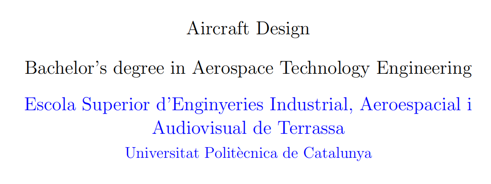
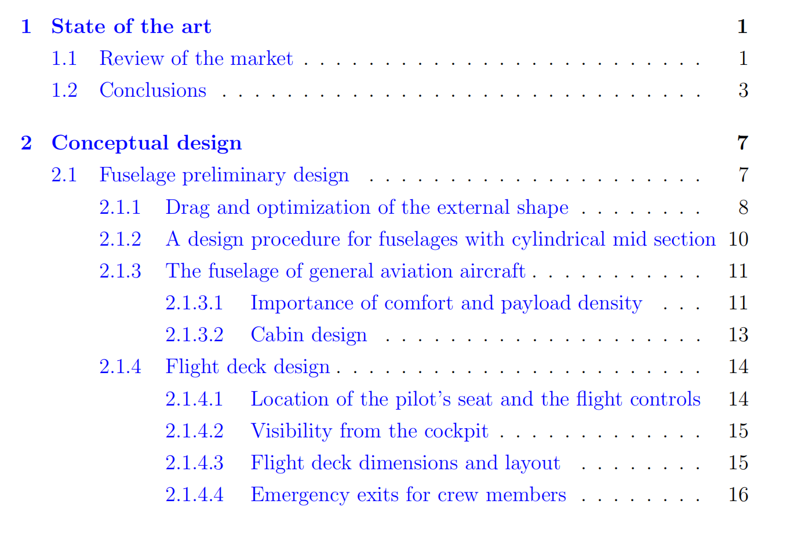
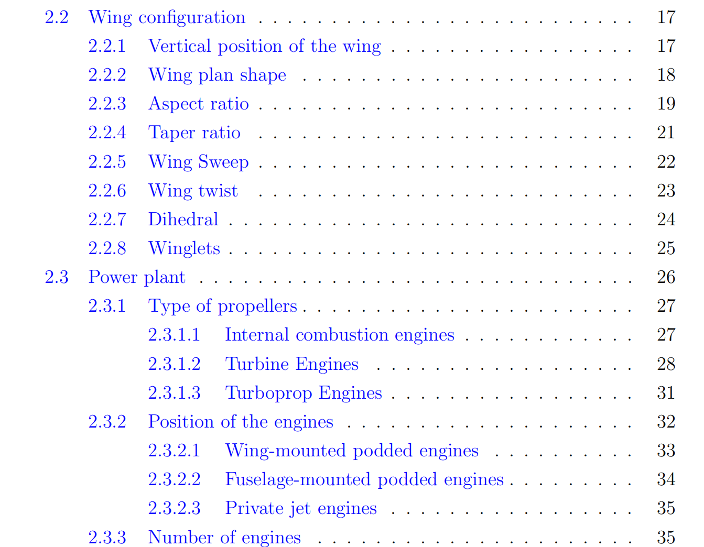
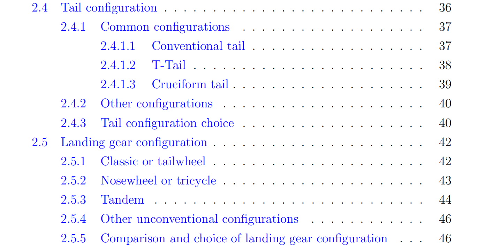
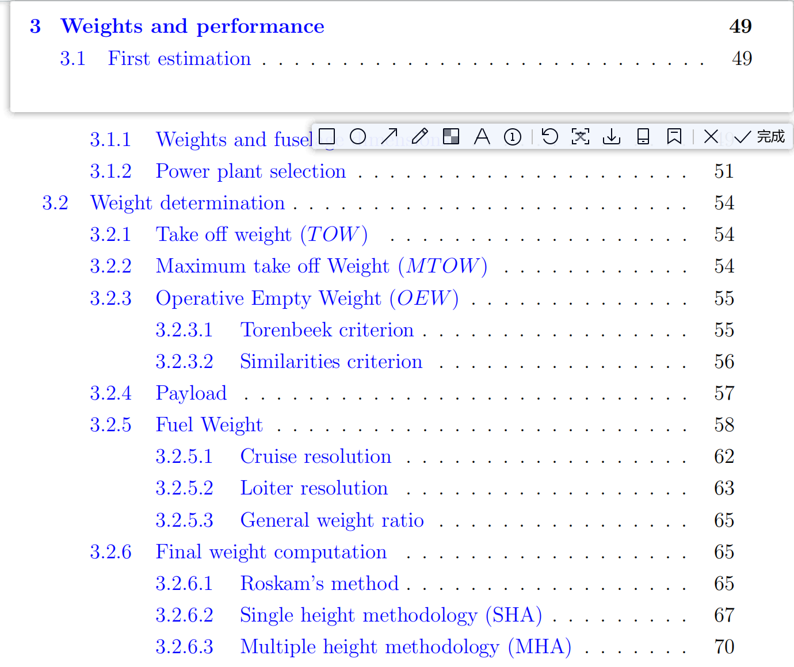
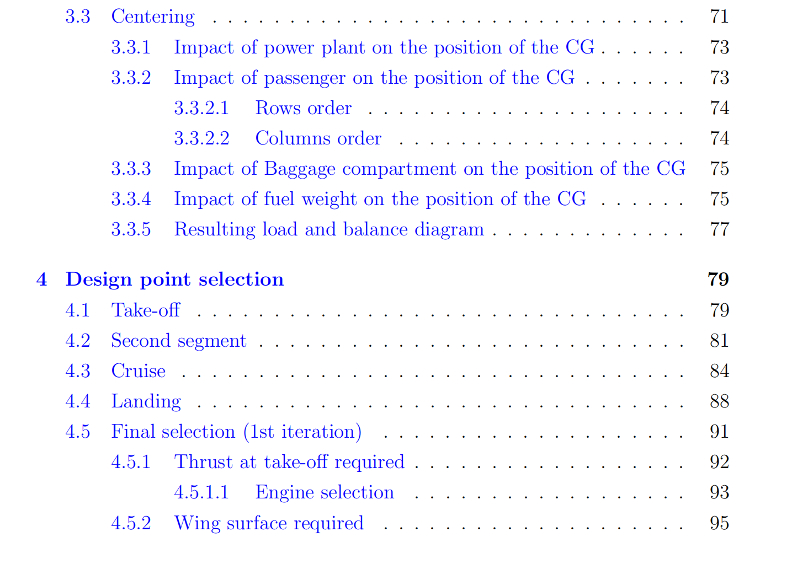
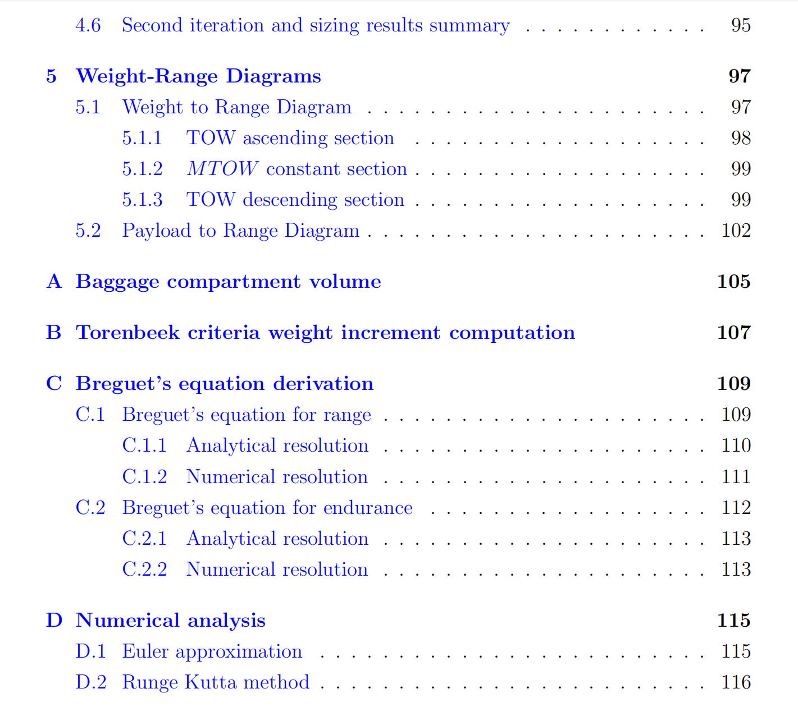
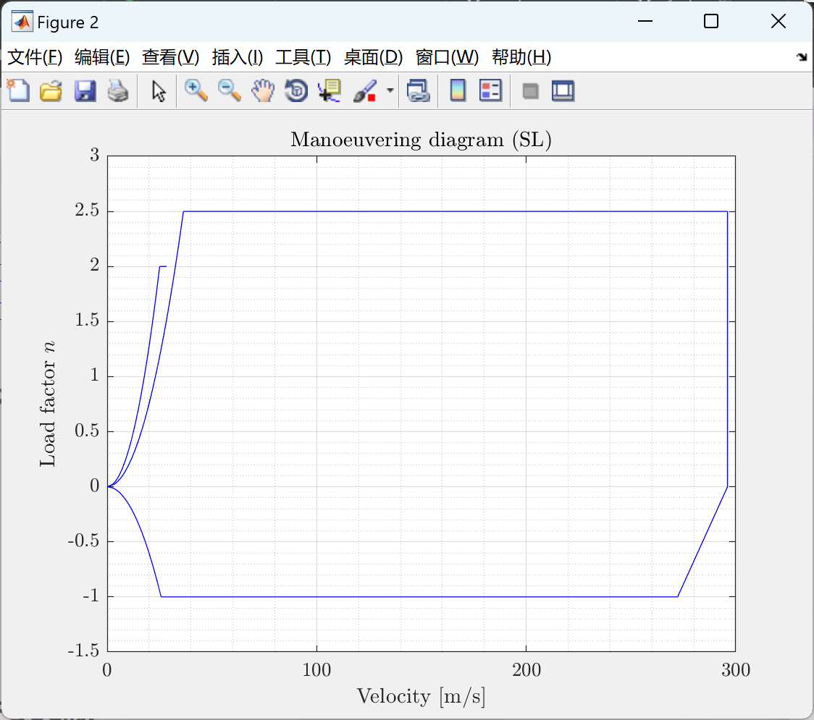
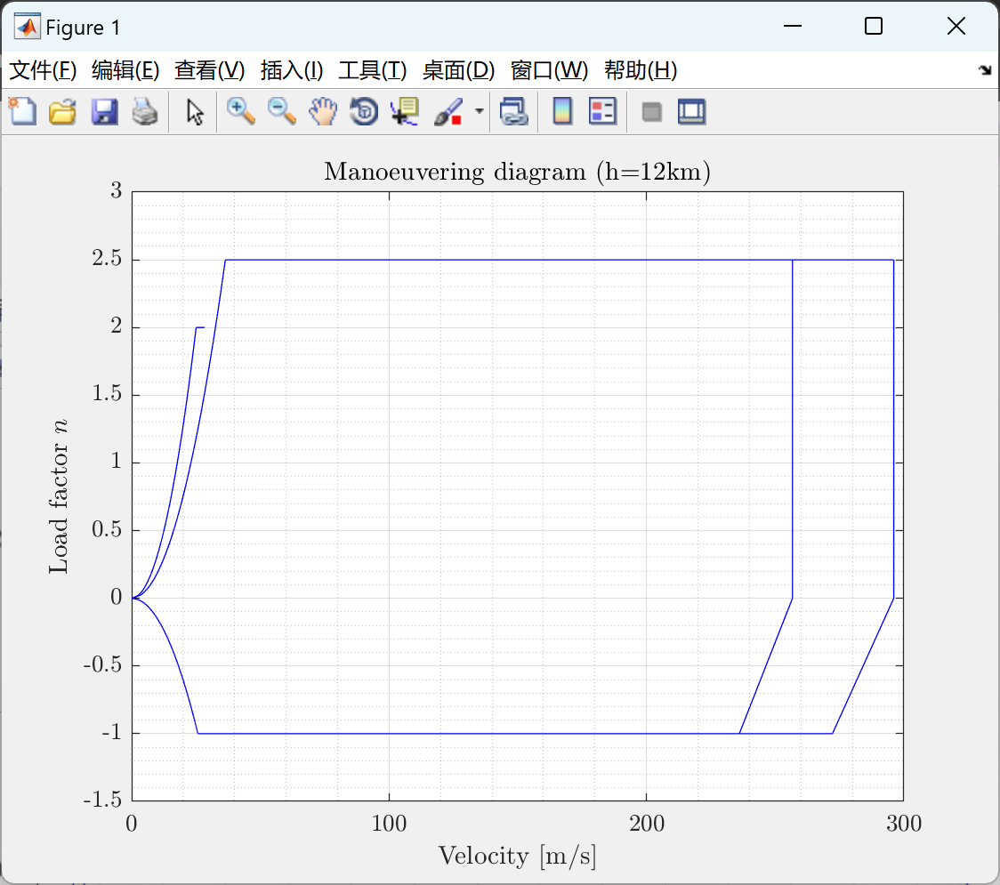
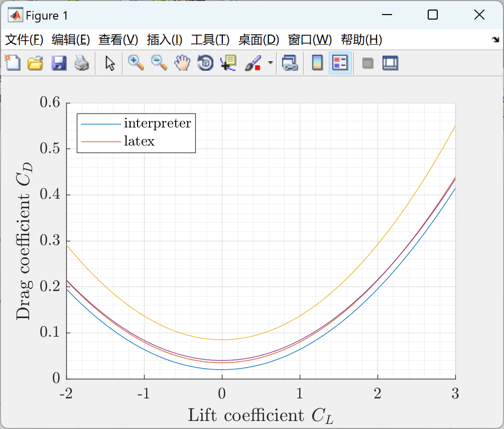
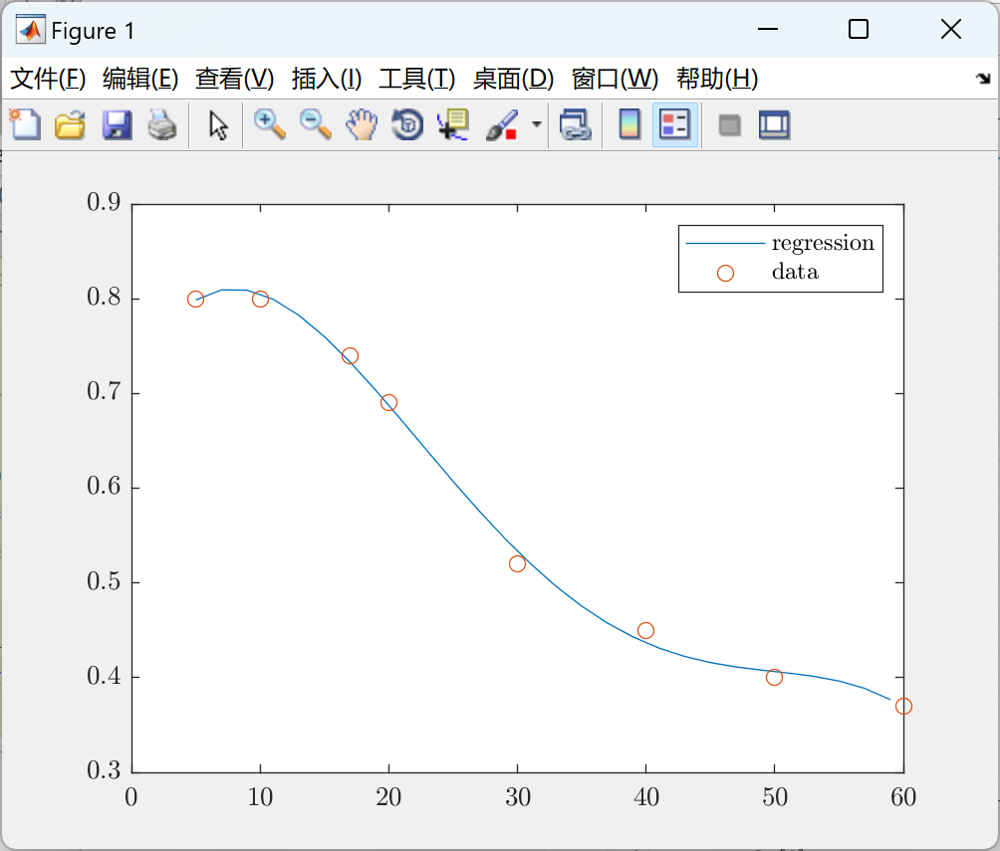
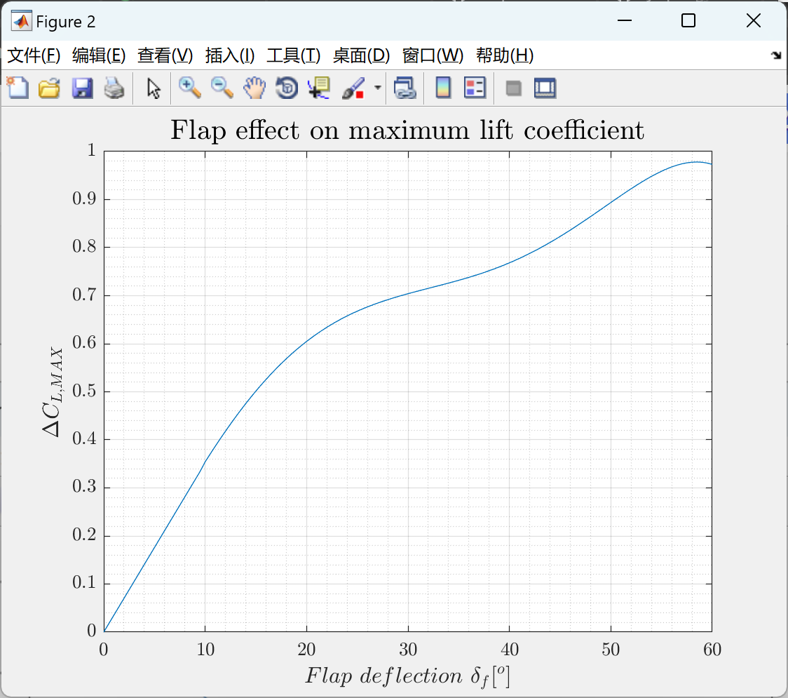

<!-- PAYMENT_BLOCK -->

## Get this dataset

- Payment link (Stripe): [Buy now](https://buy.stripe.com/3cs8yP7sY87d0vu9AB)
- Payment QR code: 

<!-- /PAYMENT_BLOCK -->
